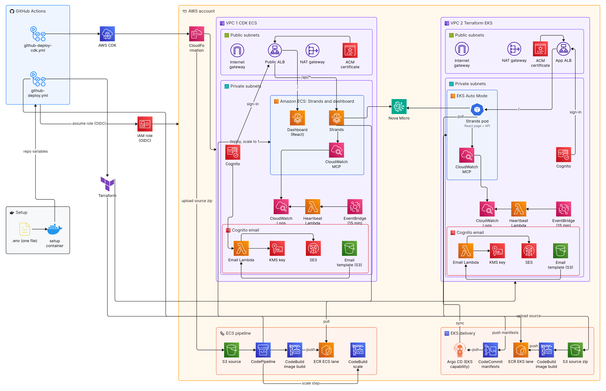

# AWS Acceleration AI Deploy

## Executive summary

One command deploys a secure platform for AI workloads into your own AWS account, and one command removes it, so it costs nothing while it is not in use. The platform runs a sample  [FastAPI](https://fastapi.tiangolo.com) agent service that answers on  [Amazon Bedrock](https://aws.amazon.com/bedrock/), behind an  [Application Load Balancer](https://aws.amazon.com/elasticloadbalancing/application-load-balancer/) where  [Cognito](https://aws.amazon.com/cognito/) signs in every visitor. Pick one of two lanes; both build the same service:

- **EKS lane.**  [Terraform](https://developer.hashicorp.com/terraform) creates a  [VPC](https://aws.amazon.com/vpc/) and an  [Amazon EKS Auto Mode](https://aws.amazon.com/eks/) cluster, and  [Argo CD](https://argo-cd.readthedocs.io) keeps the running applications in sync with the manifests committed here. Every change is a reviewed commit and rolls back the same way.
- **ECS lane.** [AWS CDK](https://aws.amazon.com/cdk/) creates the same service on  [Amazon ECS](https://aws.amazon.com/ecs/) with  [Fargate](https://aws.amazon.com/fargate/), so there are no servers or cluster to run.
- **Builds stay in your account.** [AWS CodeBuild](https://aws.amazon.com/codebuild/) builds the image from source held in  [S3](https://aws.amazon.com/s3/) into your own  [Amazon ECR](https://aws.amazon.com/ecr/). Nothing outside the account holds the source or build credentials.
- **The same run everywhere.** Every deploy runs one script inside one toolkit image, whether it starts on a laptop with  [Podman](https://podman.io) or Docker, on your own runner, or on a  [GitHub Actions](https://github.com/features/actions) cloud runner. Test it locally, then run it in the cloud unchanged.

## In action

One clip, 17 seconds, from the first command to an answer from the model:

1. **The menu.** `make` opens it inside the toolkit image. Deploy or Destroy, then the lane: Terraform on EKS, CDK on ECS, or both at once. The first deploy sets itself up.
2. **The addresses.** `make login-urls` prints the sign-in page of each lane.
3. **The sign-in.** One address opens; an email goes in; Cognito sends a one-time code. No password is ever set.
4. **The page.** The service shows its CloudWatch log check through the MCP server.
5. **The answer.** Ask sends a question to Amazon Nova and the reply appears on the page.

The same page runs on both lanes.


The clip is rendered from the repository, so it always matches the current menu and page: `make demo-gif`, `make demo-login-gif`, `make demo-app-gif`, then `make demo-combined-gif` (see `docker/recorder/README.md`). The page part is also in `assets/` as MP4.

## Architecture

Traffic reaches the service through a load balancer that requires a Cognito sign-in. Argo CD keeps the applications in sync with the manifests in this repository, and the service image is built inside the account.



## Quick start

**What you need**

- An AWS account you can sign in to.
- A GitHub personal access token for your copy of the repo (fine-grained: Actions read and write, Variables read and write). It lives in your desktop keychain, never in a file.
- On your machine: git, make, and Podman or Docker. Terraform, OpenTofu, the AWS CLI, the CDK CLI and Python come in the deploy kit image, so nothing else is installed.

**1. Get the code**

```bash
git clone https://github.com/<org>/autodeploy-eks-ai.git
cd autodeploy-eks-ai
cp .env.example .env
```

**2. Set your values**

- `.env`: `AWS_REGION`. This file is never committed.
- `terraform/terraform.tfvars`: `cognito_login_email`, your sign-in address for the EKS lane.
- `cdk/config/default.yaml`: `cognito.login_email`, the same address for the ECS lane.

Every deploy creates that Cognito user. Sign-in is a one-time code sent to it; no password is ever set.

**3. Run `make`**

```bash
make
```

The first run builds the deploy kit image (a few minutes, once). Then the menu opens inside it.

**4. Sign in to AWS** when the menu says you are not: AWS SSO with a device code (open the link on any device), a saved profile, or access keys. It is kept in your `~/.aws` for next time.

**5. Deploy**

- Pick **Deploy**, then the lane: **Terraform · EKS**, **CDK · ECS**, or **Both lanes** (two GitHub Actions runs at the same time).
- It asks before it changes anything.
- The first deploy sets itself up: it asks for your GitHub token once, creates the Terraform state bucket and lock table and the role the GitHub workflows assume, writes the backend keys to `.env` and sets your repo's Actions variables. Later deploys see those pieces and pass straight through.
- A one-lane deploy ends by printing the app's address. Open it, enter your address, and the code arrives by email.

**6. Destroy** when you are done: **Destroy**, then the lane. `make nuke` takes both lanes down through GitHub Actions at once.

**Direct commands**

- Every menu step is a target: `make deploy-cdk`, `make destroy-terraform`, and so on. `make help` lists them all.
- `make login-urls` prints both sign-in addresses. `make runs` lists the latest GitHub Actions deploy runs with links; every deploy and destroy ends with that list.
- `make github-deploy` and `make github-destroy` (`LANE=terraform|cdk` for one lane) dispatch the workflows from your laptop and print the run links. Or run `github-deploy` (EKS) or `github-deploy-cdk` (ECS) from the Actions tab. Same script, same image.
- The jobs run on self-hosted runners labeled `deploy-fleet-runners`. For GitHub's cloud runners instead, set the repo variables `TERRAFORM_RUNNER` and `CDK_RUNNER` to `ubuntu-latest` (or to your own runner's label).

## License

PolyForm Noncommercial 1.0.0, copyright Haya Tech LLC: free for noncommercial use; resale or any commercial use needs written permission first. See [LICENSE](LICENSE).
